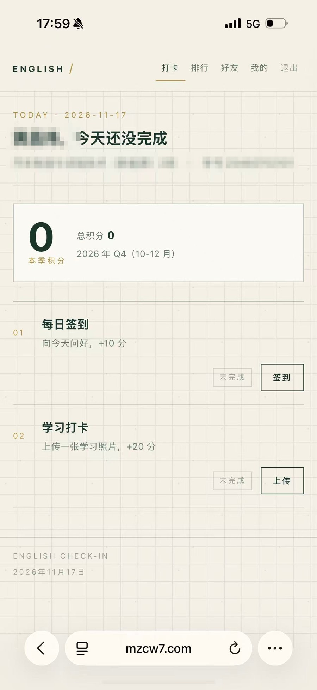
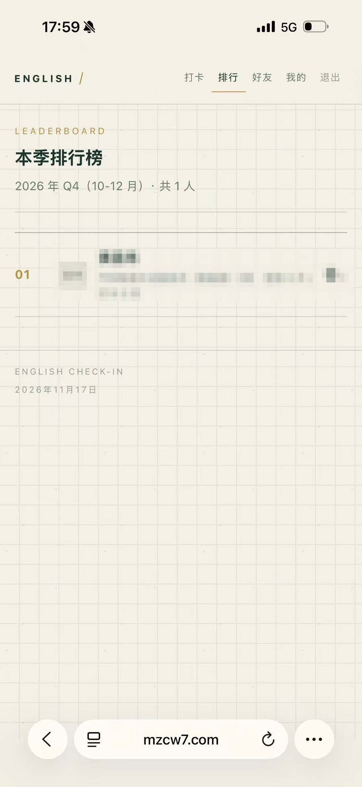
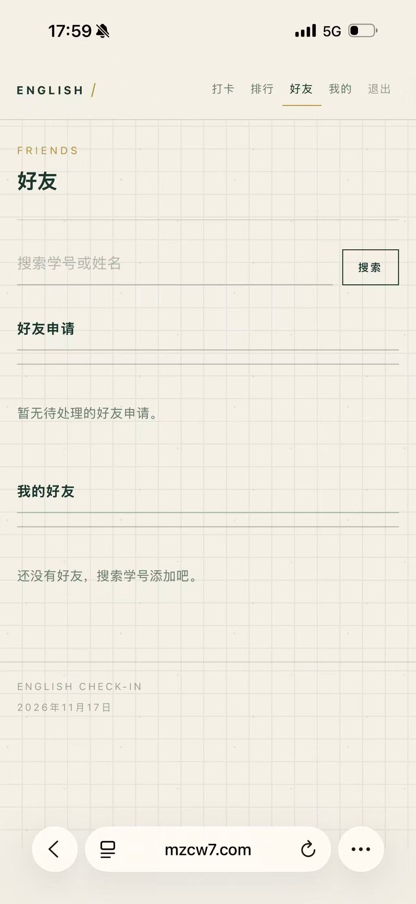
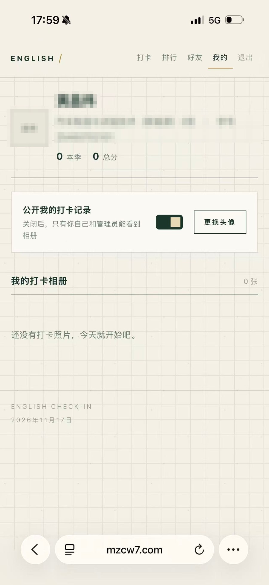

# English Check-in · 英语打卡系统

<p>
  
  
  
  
  
</p>

一个给班级使用的英语学习打卡系统：**每日签到 / 拍照打卡、季度积分排行、好友与私聊、管理后台**。

一台 2 核 4G 的小服务器就能跑，单进程、**零第三方运行时依赖**，数据全部落在一个 SQLite 文件里。

---

## 目录

- [功能](#功能)
- [技术栈](#技术栈)
- [界面](#界面)
- [快速开始](#快速开始)
- [环境变量](#环境变量)
- [生产部署](#生产部署)
- [API 一览](#api-一览)
- [设计要点](#设计要点)
- [已知限制](#已知限制)
- [License](#license)

---

## 功能

| 模块 | 能力 |
|---|---|
| 打卡 | 每日签到 +10 分；上传学习照片由 **AI 阅卷评级**（A 30 / B 25 / C 23 分）；每天各一次，照片永久保存（**业务日 07:00 刷新**） |
| 积分 | 本季积分（自然季度重置）+ 历史总积分（长期累计）双轨 |
| 排行榜 | 按本季积分排名；同分时按「历史平均打卡时间」升序（早起者靠前），并展示平均时间 |
| 个人主页 | 头像、打卡相册（网格 + 大图查看）、记录公开 / 仅自己可见 |
| AI 阅卷 | 视觉大模型区分「手写笔记 / APP 截图 / 无效图片」，返回 A/B/C/INVALID；接口超时自动降级 B 级 |
| 防作弊 | 图片 MD5 全局去重，历史照片无法重复上传；用户可对评级申诉，管理员改判并自动补扣积分 |
| 社交 | 搜索学号或姓名、好友申请（附自我介绍）、同意 / 拒绝、红点提醒 |
| 聊天 | 好友之间 1v1 私聊，2.5 秒轮询，微信式气泡 |
| 点赞 | 每天可给同一人点一次，红心飘起动画 |
| 管理后台 | 用户总览、查看任意用户全部照片（无视隐私开关）、软删除违规照片、清空本季积分、导出 CSV |

## 技术栈

| 层 | 选型 | 说明 |
|---|---|---|
| 前端 | 原生 HTML / CSS / JavaScript | 无框架、无构建步骤，移动端优先 |
| 后端 | Node.js ≥ 22 | `node:http` + `node:sqlite` + `node:crypto`，**零 npm 依赖** |
| 数据库 | SQLite（单文件） | WAL 模式，唯一索引 + 软删除 |
| 反向代理 | Caddy 2 | 自动申请/续期 Let's Encrypt 证书，HTTP→HTTPS 跳转 |
| 进程管理 | systemd | 开机自启、崩溃自动重启 |

## 界面

全部为原生实现，无 UI 框架：

- **登录 / 注册**：墨绿 + 米白杂志风，密码框带「小眼睛」显示切换
- **打卡主页**：本季/总积分看板，签到与打卡两个任务条，上传前二次确认并预览
- **排行榜**：名次、头像、班级、积分，点击进入个人名片
- **个人主页**：头像、相册网格、隐私开关
- **好友 / 聊天**：好友申请带红点，聊天页极简气泡
- **管理后台**：数据总览、用户表格、照片软删除、CSV 导出

<p align="center">
  
  
  
  
</p>

> 截图中的姓名、班级、学号与头像均已打码处理。
> 设计基调：`#1A362D` 墨绿 / `#F3F0E7` 米白 / `#B9923F` 淡金，直角、细线、杂志式排版。

## 快速开始

```bash
# 需要 Node.js >= 22（推荐 24）
node -v

cp .env.example .env
# 编辑 .env，至少设置 SUPER_ADMIN_PASSWORD

npm start          # 或 node server.js
```

打开 <http://127.0.0.1:3000>，用 `.env` 中的超管账号登录后台。

首次启动会自动建表、创建 `uploads/`，并在库中没有 `super_admin` 时按环境变量创建管理员。

## 环境变量

| 变量 | 默认值 | 说明 |
|---|---|---|
| `PORT` | `3000` | 监听端口 |
| `HOST` | `127.0.0.1` | 监听地址，建议只监听回环，由 Caddy 反代 |
| `APP_SECRET` | 自动生成 | 会话签名密钥；留空则生成到 `.secret`（已忽略） |
| `SUPER_ADMIN_ID` | `3321` | 超管学号（可短于 8 位，登录不做格式校验） |
| `SUPER_ADMIN_PASSWORD` | 无 | 超管初始密码；**为空则跳过管理员初始化** |
| `AI_PROVIDER` | `mock` | `mock` / `zhipu` / `qwen`；无 Key 时自动 mock |
| `ZHIPU_API_KEY` | 无 | 智谱 Key；填了并设 `AI_PROVIDER=zhipu` 即走真实模型 |
| `AI_API_KEY` | 无 | 视觉模型 Key；为空则强制 mock |
| `AI_MODEL` | `glm-4.6v-flash` | 可覆盖，如 `qwen-vl-plus` |
| `AI_TIMEOUT_MS` | `10000` | 超时即降级 B 级 |
| `RESET_HOUR` | `7` | 业务日刷新小时。默认 7 点，即 00:00–06:59 仍算前一天 |

## 生产部署

```bash
# 1. 放置代码
sudo mkdir -p /opt/english-checkin && sudo cp -r . /opt/english-checkin
cd /opt/english-checkin

# 2. 配置并收紧权限
sudo cp .env.example .env && sudo vi .env
sudo chmod 600 .env

# 3. 独立运行用户
sudo useradd -r -s /sbin/nologin -d /opt/english-checkin english
sudo chown -R english:english /opt/english-checkin

# 4. systemd
sudo cp deploy/english-checkin.service /etc/systemd/system/
sudo systemctl daemon-reload
sudo systemctl enable --now english-checkin

# 5. Caddy 反代（自动 HTTPS）
sudo cp deploy/Caddyfile.example /etc/caddy/Caddyfile
sudo vi /etc/caddy/Caddyfile      # 把 example.com 换成你的域名
sudo systemctl reload caddy
```

域名需先解析到服务器公网 IP，并放行 80 / 443。Caddy 会自动签发并续期证书。

## API 一览

| 方法 | 路径 | 说明 |
|---|---|---|
| POST | `/api/register` | 注册（学号 8-12 位纯数字、姓名中文） |
| POST | `/api/login` | 登录，返回 HttpOnly 会话 Cookie |
| POST | `/api/logout` | 退出（清 Cookie + `Clear-Site-Data`） |
| GET | `/api/me` | 当前用户、今日状态、积分、季度信息 |
| POST | `/api/check-in` | 每日签到 |
| POST | `/api/upload` | 每日打卡（multipart，字段 `image`） |
| POST | `/api/avatar` | 上传头像（字段 `avatar`） |
| PATCH | `/api/privacy` | 相册公开 / 私密 |
| GET | `/api/leaderboard` | 本季排行榜（排除管理员） |
| GET | `/api/users/:id` | 个人名片 + 相册（受隐私控制） |
| GET | `/api/users/search?q=` | 按学号 / 姓名搜索 |
| POST | `/api/like/:id` | 点赞（每人每天一次） |
| GET / POST | `/api/friend-requests` | 好友申请列表 / 发起申请 |
| POST | `/api/friend-requests/:id/accept\|reject` | 同意 / 拒绝 |
| GET / POST | `/api/messages` | 聊天记录 / 发送消息（仅好友） |
| GET | `/api/admin/overview` | 管理后台总览 |
| GET | `/api/admin/users/:id` | 任意用户详情（无视隐私） |
| POST | `/api/admin/records/:id/delete` | 软删除违规照片 |
| POST | `/api/admin/reset-quarter` | 清空本季积分 |
| GET | `/api/admin/export.csv` | 导出积分 CSV |

## 设计要点

- **鉴权**：HMAC-SHA256 签名 Cookie，token 带 `iat` 且必须晚于账号创建时间，防止清库重建后旧凭证复活
- **密码**：PBKDF2-SHA256，21 万次迭代 + 16 字节随机盐
- **打卡唯一性**：`UNIQUE(user_id, record_day) WHERE type='upload'`，绕过 API 直接写库也无法重复
- **照片不可删**：用户侧没有任何删除接口；管理员只能软删除（`deleted_at` 标记，文件保留可追溯）
- **积分**：本季积分按 `created_at >= 季度起点` 聚合，历史总分单独累计，互不影响
- **时间**：统一存北京时间字符串（`+08:00`），避免时区错乱
- **业务日**：每日 07:00 切换（`lib/business-day.js`）。凌晨 00:00–06:59 仍写入前一天，可补打；07:00 后进入新的一天
- **平均打卡时间**：按真实点击时间戳（北京时间 HH:mm）求均值，凌晨打卡也按真实时刻计算

## 已知限制

- 聊天为轮询实现（2.5s），非 WebSocket；个人小班场景足够，量大需改造
- 好友申请为单向发起 + 对方同意，无「删除好友」入口
- 无邮箱验证 / 找回密码，账号由管理员管理

## License

[MIT](https://opensource.org/licenses/MIT)
